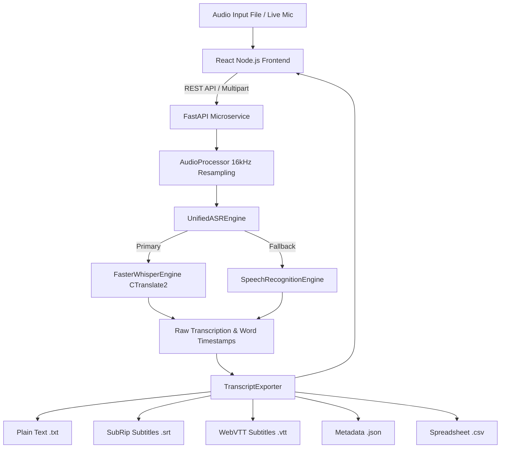

# 🎙️ Automatic Speech Recognition (ASR) Studio
Developed by **[Karthig Rajan S](https://github.com/Rajan3103)**

[](https://nodejs.org/)
[](https://www.python.org/)
[](LICENSE)
[](https://github.com/openai/whisper)
[](https://github.com/Rajan3103)
[](tests/)

A high-performance, production-ready **Automatic Speech Recognition (ASR) Studio** powered by OpenAI's Whisper model architecture (via CTranslate2 optimized `faster-whisper`), fallback engines, a modern **Node.js (React + Vite)** frontend with the **Emerald Matrix** UI design system, a **FastAPI** REST microservice, and a **CLI Tool**.

---

## 🌟 Key Features

- **Modern Node.js (React + Vite) Studio UI**:
  - **Emerald Matrix / Dark Velvet Theme** with dynamic live theme switcher (Cyber Obsidian, Deep Nebula, Tokyo Sunset, Nordic Frost).
  - **Drag & Drop Audio Upload** with support for WAV, MP3, FLAC, M4A, AAC, and OGG formats.
  - **Live Web Audio Recording**: Microphone input with real-time waveform visualizer canvas.
  - **Audio Signal Analyzer**: Computes duration, RMS energy, sample rate, and peak amplitude metrics.
  - **Timed Segments Inspector**: Interactive per-segment timestamps and confidence score breakdown.
  - **1-Click Subtitle Exports**: Instant downloads for `.SRT`, `.VTT`, `.JSON`, `.TXT`, and `.CSV`.
  - **Synthetic Wave Benchmark & Batch Queue**: Test pipeline latency and queue multi-file batch jobs.
- **High-Speed Speech Recognition Backend (FastAPI)**:
  - Powered by CTranslate2 optimized `faster-whisper` for 4x-16x real-time inference speed.
  - Automatic fallback to standard speech recognition engine.
  - Voice Activity Detection (VAD) via Silero to filter background noise and silence.
  - Multi-lingual transcription across 90+ languages & English translation.

---

## 🛠️ Tools & Technologies Used

| Layer | Technology / Library | Purpose |
| :--- | :--- | :--- |
| **Frontend UI** | [React 19](https://react.dev/), [Vite](https://vitejs.dev/), [Lucide Icons](https://lucide.dev/) | Modern cyber-styled web dashboard |
| **Backend API** | [FastAPI](https://fastapi.tiangolo.com/), [Uvicorn](https://www.uvicorn.org/) | High-speed REST API endpoints & CORS handler |
| **ASR Core** | [Faster-Whisper](https://github.com/SYSTRAN/faster-whisper) (CTranslate2) | Transformer-based speech recognition & translation |
| **Audio Processing** | [SoundFile](https://python-soundfile.readthedocs.io/), [SciPy](https://scipy.org/), `wave` | Audio resampling to 16kHz PCM, signal normalization |
| **CLI & Testing** | `argparse`, [PyTest](https://docs.pytest.org/), `httpx` | Single/batch CLI tool & unit test suite |

---

## 📐 System Architecture



---

## 📂 Project Structure

```
asr-tool-implementation/
├── frontend/                  # Modern Node.js (React + Vite) Frontend
│   ├── src/
│   │   ├── App.jsx            # Main ASR Studio Interface
│   │   ├── index.css          # Emerald Matrix Design System & Themes
│   │   └── main.jsx           # React Entry Point
│   ├── package.json           # Node dependencies
│   ├── vite.config.js         # Vite configuration & backend proxy
│   └── index.html             # HTML shell
├── asr_tool/                  # Core Python ASR Package & REST API
│   ├── __init__.py            # Package metadata & exports
│   ├── config.py              # Configuration dataclasses & Enums
│   ├── audio_processor.py     # Signal loading, resampling, metrics & synthesis
│   ├── engine.py              # Faster-Whisper & fallback engine implementations
│   ├── exporters.py           # TXT, SRT, VTT, JSON, CSV exporters
│   ├── cli.py                 # Command-line interface
│   └── api.py                 # FastAPI microservice endpoints
├── tests/                     # Test Suite (20 passed)
│   ├── test_api.py
│   ├── test_audio_processor.py
│   ├── test_engine.py
│   ├── test_exporters.py
│   └── test_cli.py
├── package.json               # Root scripts
├── requirements.txt           # Python backend dependencies
├── LICENSE                    # MIT License
└── README.md                  # Documentation
```

---

## 🚀 Quick Start Guide

### 1. Prerequisites
- Python 3.10+
- Node.js 18+ and npm

### 2. Setup Backend & Install Dependencies
```bash
# 1. Clone repository
git clone https://github.com/Rajan3103/asr-tool-implementation.git
cd asr-tool-implementation

# 2. Setup Python environment
python -m venv .venv
# Windows:
.venv\Scripts\activate
# Linux/macOS:
source .venv/bin/activate

# 3. Install Python backend requirements
pip install -r requirements.txt
```

### 3. Setup Frontend
```bash
cd frontend
npm install
```

---

## 💻 Running the Application

### 1. Start FastAPI Backend Microservice:
```bash
# From workspace root (with .venv active):
uvicorn asr_tool.api:app --host 0.0.0.0 --port 8000 --reload
```
- **API Docs (Swagger)**: `http://localhost:8000/docs`

### 2. Start Node.js Frontend App:
```bash
# In another terminal:
cd frontend
npm run dev
```
- **Live Studio Dashboard**: Open `http://localhost:3000`

---

## 🧪 Running Unit Tests
```bash
pytest -v
```

---

## 📜 License
This project is licensed under the [MIT License](LICENSE) by **Karthig Rajan S**.
